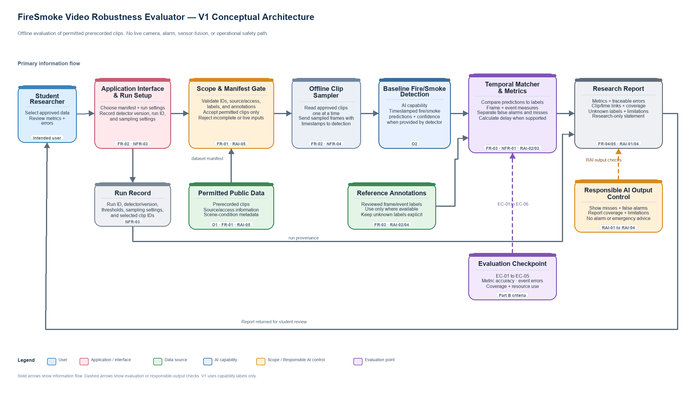

# Week 2 Architecture Decisions and Traceability

## V1 architecture

V1 is an offline research workflow for a student to evaluate a baseline fire/smoke detector on permitted prerecorded clips. It uses functional component names and does not select a particular model, programming framework, data store, or deployment platform.

### Starting point and justified additions

The simplest candidate flow is **student → application interface → baseline fire/smoke detector → result summary**. It can produce detector outputs, but it cannot validate clip provenance, compare predictions with temporal reference annotations, or make dataset coverage and missed events traceable. V1 therefore adds only the manifest gate, incremental clip sampler, temporal matcher/metrics, run record, evaluation checkpoint, and report controls needed for FR-01/FR-03, NFR-01/NFR-03/NFR-04, the selected Part B criteria, and the Responsible AI requirements.

### Main flow

1. The student selects a dataset manifest and an evaluation configuration through the application interface. The interface records the run settings and detector version for later reproduction.
2. A scope and manifest gate checks that selected inputs are prerecorded clips and that required source, access, label, and annotation information is present. It rejects missing or unsupported entries before processing.
3. An offline clip sampler reads approved clips incrementally and passes sampled frames with timestamps to a baseline fire/smoke detection capability.
4. A temporal matcher and metrics component compares predictions with reference annotations. It calculates only the metrics supported by the available labels and keeps event matches, false alarms, missed events, and detection delay traceable to clip IDs and times.
5. A research report returns metric summaries, error examples, scene coverage, unknown labels, run configuration, dataset limitations, and the research-only safety statement to the student.

The evaluation criteria checkpoint points to the outputs that will be assessed later. Responsible AI controls apply at input selection and report generation. Raw video remains in its permitted local source location and is not included in the public repository unless redistribution is allowed.

## Architecture Decision Records

### ADR-01 — Validate the dataset manifest before clip processing

| Field | Decision |
|---|---|
| Requirement / constraint | FR-01 and RAI-05 require identifiable clips, source/access information, and usable annotations. Only data permitted for the project may be selected. |
| Alternatives considered | Read a folder of clips without metadata; accept a manifest without validation; validate a manifest before processing. |
| Selected option | Use a manifest with a scope and provenance gate that checks required fields and restricts V1 inputs to permitted prerecorded clips. |
| Trade-off accepted | Students must prepare and maintain metadata, and incomplete entries are rejected. This adds setup work but makes source permissions, labels, and dataset coverage auditable. |

### ADR-02 — Separate temporal evaluation from detector inference

| Field | Decision |
|---|---|
| Requirement / constraint | FR-03, FR-04, NFR-01, RAI-02, and RAI-03 require frame/event metrics and traceable misses and false alarms. |
| Alternatives considered | Report only detector frame scores; send detector outputs directly to a summary; compare timestamped predictions with reference annotations in a separate temporal evaluation component. |
| Selected option | Use a temporal matcher and metrics component after the baseline detector. Keep the detector capability and evaluation logic conceptually separate. |
| Trade-off accepted | Timestamp alignment and event annotation require additional processing, and sources without temporal labels cannot support all event metrics. The separation makes event-level errors and metric calculations easier to check. |

### ADR-03 — Return a research report with explicit limits

| Field | Decision |
|---|---|
| Requirement / constraint | FR-05, RAI-01, RAI-02, RAI-04, and NFR-03 require understandable outputs, visible errors and coverage, a research-only boundary, and run information. |
| Alternatives considered | Return raw detector outputs only; return aggregate scores only; create a report containing metrics, clip/time error links, coverage, run provenance, and limitations. |
| Selected option | Provide a research report with separate false-alarm and missed-event results, scene/unknown coverage, configuration details, and a prominent offline-research limitation. No alarm, dispatch, or emergency advice is included. |
| Trade-off accepted | Reports require more fields and take longer to review than a single score. This makes interpretation safer and supports reproducible student analysis. |

## Initial Requirements Traceability Matrix

| Objective | Requirement | Evaluation criterion | Architecture element | Later evidence |
|---|---|---|---|---|
| O1 — Select and document suitable data | FR-01, RAI-05 | EC-04 — provenance, coverage, and unknown-label integrity | Dataset manifest and scope/provenance gate | Run valid and invalid manifest fixtures; reconcile selected clips, source/access fields, labels, and unknowns with the coverage summary. |
| O2 — Build an offline evaluation workflow | FR-02, NFR-04 | EC-05 — resource demand | Application interface and run setup; offline clip sampler; baseline detector | Process a permitted test input; retain timestamped predictions and record the declared computer, detector, sampling settings, peak memory, and elapsed time. |
| O3 — Evaluate detector behaviour with evidence | FR-03, NFR-01 | EC-01 and EC-02 — metric correctness and supported-metric coverage | Temporal matcher and metrics | Compare output counts, ratios, and detection delay against independently calculated labelled fixtures; mark unsupported metrics unavailable. |
| O3 — Make important errors and dataset limits visible | RAI-02, RAI-04, FR-04 | EC-03 and EC-04 — missed-event traceability and coverage | Research report and Responsible AI reporting controls | Reconcile every annotated event and processed clip against the report; verify each miss has a clip/time reference and unknown conditions remain explicit. |

## V1 review

- Each major component supports an identified requirement or evaluation need.
- Data sources include prerecorded clips, reference annotations, and source/access and scene metadata.
- Input controls address source/access checks and reject live-camera use; report controls show missed events, false alarms, unknown coverage, and the research-only limitation.
- The evaluation point is linked to EC-01 through EC-05.
- No specific model, database, web service, live-camera integration, alarm function, or sensor-fusion component is added at V1.
- A simpler query-to-model-to-answer flow would not compare video predictions with temporal reference annotations, so the manifest gate and temporal evaluation component are justified by the stated requirements.

## Part C reflection

**ADR-02 has the most important trade-off.** FR-03 and RAI-02 require event-level results and visible misses, so a separate temporal matcher is needed beyond a simple detector-to-report flow. It adds annotation alignment and processing work, and it limits event metrics to sources with suitable temporal labels. I accept that added complexity because frame-level scores alone can hide missed events and detection delay.

## Part C completion check

- [x] Created a V1 conceptual architecture showing the user, interface, AI capability, output, data sources, controls, and major information flows.
- [x] Kept components at the functional/capability level rather than selecting implementation technologies.
- [x] Recorded at least two requirement-linked architecture decisions and their trade-offs.
- [x] Completed a traceability matrix with four objective-to-evidence rows.
- [x] Reviewed the architecture against the requirements and evaluation criteria.

